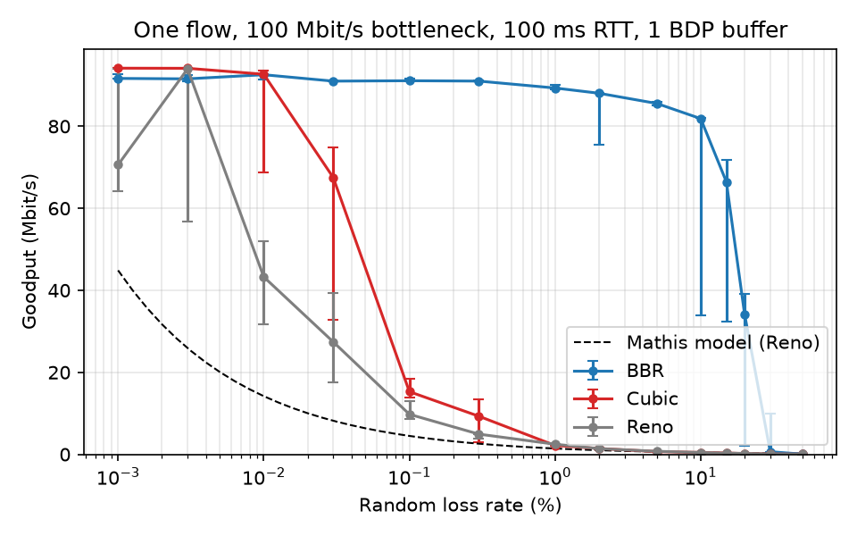

# Plan

The project reproduces published congestion-control results on a laptop, then
checks a from-scratch user-space implementation against the Linux kernel on the
same experiments. Every phase ends with a figure and a short written finding.

| Phase | Question | Reference | Status |
| --- | --- | --- | --- |
| 0 | Can a rootless namespace testbed emulate a 100 Mbit/s, 100 ms link faithfully? | — | done |
| 1 | How does goodput fall as random loss rises, for loss-based (CUBIC, Reno) vs. model-based (BBR) control? | Cardwell et al., ACM Queue 2016 | done — see below |
| 2 | How much queueing delay does each algorithm add as the bottleneck buffer grows (bufferbloat)? | Cardwell et al., 2016 | planned |
| 3 | When BBR shares a bottleneck with N CUBIC flows, what share does it take, and how does that depend on buffer size? | Ware et al., IMC 2019 | planned |
| 4 | Do from-scratch user-space Reno/CUBIC/BBRv1 implementations over UDP match the kernel on phases 1–3? | — | planned |
| 5 | Paper-style report | — | planned |

## Phase 0 — testbed validation (100 Mbit/s, 100 ms, 1 BDP, CUBIC, no loss)

| Check | Expected | Measured |
| --- | --- | --- |
| Base RTT (`min_rtt` from TCP_INFO) | 100 ms | 100.016 ms |
| Steady-state goodput | 96.5 Mbit/s (1448/1500 of 100 Mbit/s) | 95.6 Mbit/s |
| Where drops happen | only at the bottleneck buffer | 91 drops at tbf, none elsewhere |

## Phase 1 — goodput vs. random loss

Setup: one 30 s flow, 100 Mbit/s, 100 ms RTT, 1 BDP buffer, 14 loss rates, 3 runs each
(median, whiskers = min/max). Raw numbers: `results/loss_sweep/summary.csv`.

| Paper claim (Cardwell et al. 2016) | Our result |
| --- | --- |
| CUBIC's throughput falls 10x at 0.1% loss | 94.2 -> 15.3 Mbit/s (6.2x) |
| CUBIC totally stalls above 1% | 2.2 Mbit/s at 1%, 0.67 at 5% |
| BBR meets the limit `rate x (1 - loss)` up to 5% loss | 85.6 Mbit/s at 5% vs. limit 87.0 |
| BBR is close to that limit up to 15% | 81.9 vs. 82.4 at 10%; 66.5 vs. 77.9 at 15%; collapses by 20-30% |

The qualitative result reproduces. Two differences we have not explained yet:

1. **Without loss BBR sits about 3% below CUBIC** (91.6 vs. 94.2 Mbit/s). Candidate: BBR's
   ProbeRTT phase, which drains the pipe to 4 packets every 10 s.
2. **Reno beats the Mathis model by about 2x at 0.1-1% loss.** Candidate: the model's `p` is
   the rate of congestion *events*, and several random losses inside one window cause only one
   window reduction. Testable from the `ca_state` and `snd_cwnd` samples we already record.

Variance is large at the transition points (e.g. BBR at 10%: 33.8-82.1 Mbit/s), which is why
every point is repeated. One CUBIC run at 50% loss hit the per-run timeout and is missing.

## Known limitations

- `netem` random loss is not seedable on iproute2 6.1, so every point is repeated
  and reported as median with min–max.
- Flows run 30 s instead of the paper's 60 s.
- Loss is applied only on the data path; ACKs are never dropped.
- BBR needs the `tcp_bbr` module loaded once on the host (`sudo modprobe tcp_bbr`).
